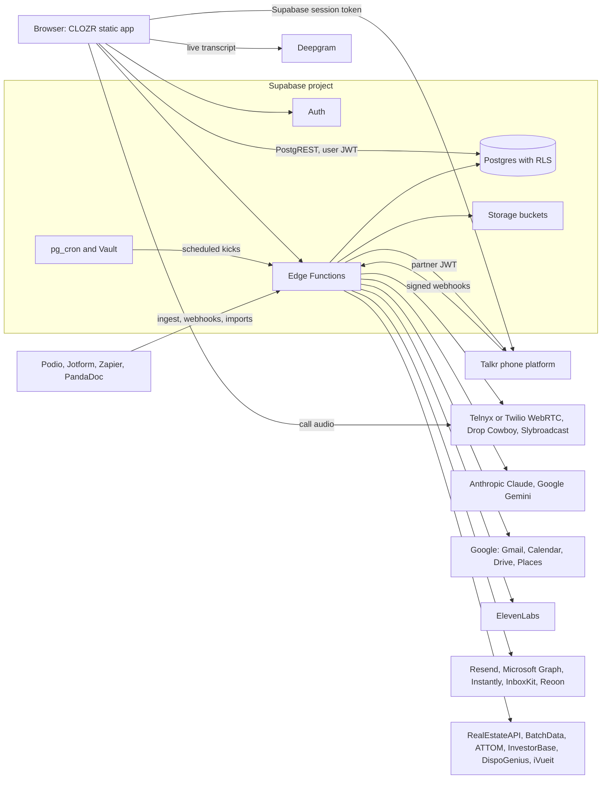
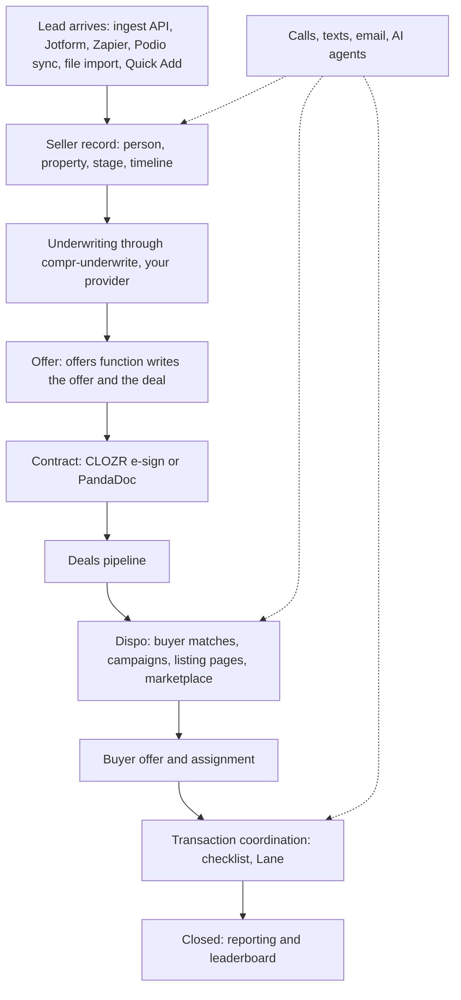
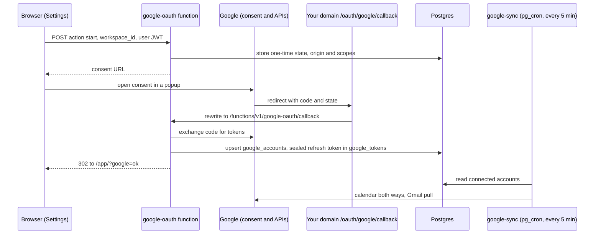
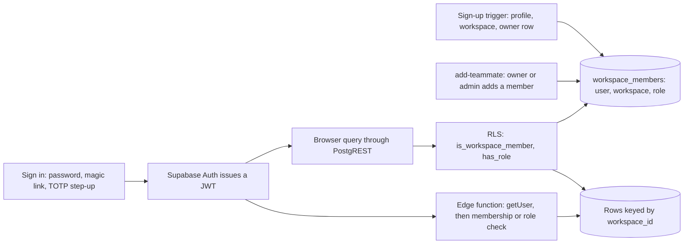

# CLOZR

CLOZR is an open-source CRM for real-estate acquisition companies: wholesalers,
flippers and buy-and-hold teams that buy houses directly from sellers and
assign or resell them to cash buyers. The lead, the property, the
underwriting, the calls and texts, the contract, the buyers, the disposition
and the closing live in one workspace and one interface.

It ships as a static Next.js export (`app/`) on top of Supabase (Auth,
Postgres with row-level security, Storage, pg_cron, Vault and 69 Deno edge
functions). Calling and SMS run through [Talkr](#the-phone-talkr), a separate
open-source phone platform.

- New here? Run the demo: [Quick start](#quick-start).
- Standing up your own copy? Follow [SETUP.md](SETUP.md).
- Having an AI coding assistant do the setup? Point it at
  [SETUP-WITH-AI.md](SETUP-WITH-AI.md).

## Contents

- [What is not included](#what-is-not-included)
- [Demo mode](#demo-mode)
- [How it fits together](#how-it-fits-together)
- [Features](#features)
- [Quick start](#quick-start)
- [Production setup in brief](#production-setup-in-brief)
- [OAuth and Auth settings](#oauth-and-auth-settings)
- [Environment variables and secrets](#environment-variables-and-secrets)
- [The phone: Talkr](#the-phone-talkr)
- [Project layout](#project-layout)
- [Development](#development)
- [Deploying the frontend](#deploying-the-frontend)
- [Security](#security)
- [Contributing](#contributing)
- [License](#license)

## What is not included

- **A comps and valuation engine.** The underwriting screens call one edge
  function, `app/supabase/functions/compr-underwrite`. In this release it
  answers every request with "No underwriting provider is configured for this
  install." and the app shows its underwriting controls as unavailable. Bring
  your own engine (ARV, rehab, offer, comps) by replacing that handler. Its
  header comment lists where the request and response shapes are defined
  (`app/lib/compr.ts`, `app/lib/deal-files.ts`, `app/lib/places.ts`).
- **Data scrapers.** The deed scraper and the Facebook tooling behind
  wholesale sniping and Deal Machine (including the Deal Machine Chrome
  extension) are not in this repository. Those screens and their edge functions
  remain and expect you to bring the data. Buyr's buyer search runs on your own
  data API keys or a [Buyr](https://www.buyrs.app/) API key; see
  [Buyr: your keys or ours](#buyr-your-keys-or-ours).
- **Company data.** No customer records, scripts or branding from any company
  are included. All demo data is made up.

## Demo mode

`/demo` runs the whole app on a bundled sample graph (`app/lib/clozr-data.ts`)
with no backend and no sign-in. Nothing saves. If `NEXT_PUBLIC_SUPABASE_URL`
and `NEXT_PUBLIC_SUPABASE_PUBLISHABLE_KEY` are unset, the app still builds and
`/demo` still works; only `/app` (the signed-in CRM) needs Supabase.

## How it fits together

### Architecture

CLOZR has no application server. The browser talks to Supabase and to Talkr
directly; everything that needs a secret runs in an edge function.



Every third party except Supabase and Talkr is optional. Each feature that
needs one checks for its key and says so in the UI when it is missing.

### From lead to close



### Google connection



The `V` hop exists only when you set `GOOGLE_REDIRECT_URI` to your own domain.
Without it, Google redirects straight to the Supabase function URL. See
[OAuth and Auth settings](#oauth-and-auth-settings).

### Sign-in and tenancy



One Postgres, partitioned by `workspace_id`. Every data table has RLS. Roles
are `owner`, `admin`, `acquisitions`, `dispositions`, `tc`, `member`, plus
`notary` and `partnerships` for invited people. The role table is in
[docs/security.md](docs/security.md).

## Features

### Command and navigation

- **One shell.** A 56px top nav with the product links and a Tools menu,
  notifications, the Ask CLOZR drawer and a floating dialer host every screen.
- **⌘K command bar** (Ctrl+K). Search and verbs in one box: `call kara`,
  `text kara`, `task kara tomorrow 10am`, `underwrite`, `send offer`, `move`,
  `go reports`, `new lead`. A role is offered only the verbs its screens allow.
  Grammar in `app/lib/command.ts`.
- **Quick Add** on `Q`: one dialog for a new lead, buyer, property, deal or
  vendor, with duplicate checks (`app/lib/quick-add-dupes.ts`).
- **Home**: priority queue, inbound, upcoming closings, at-risk deals, AI
  alerts and the team feed.
- **Today**: the rep's call list with the seller in view and an outcome rail;
  `clozr-today` has Claude rank the 3 to 6 things to do first.
- **View as**: an owner or admin previews CLOZR read-only as a teammate sees it.

### Leads and People

- **People**: smart lists, a selectable record table and mass actions
  (assign, skip trace, send to a Talkr campaign, enroll in automated texts).
- **Round robin**: each ingest key names the rotation its new leads are dealt
  to; dispositions rotations deal deals by type.
- **Bulk skip trace** for sellers and buyers through Buyr's
  `skiptrace` (RealEstateAPI for individuals, BatchData for LLCs), with a
  monthly credit cap.
- **Reactivation lists** and the nightly AI Autopilot pass over aged leads.
- **Blacklist** and do-not-contact handling across People and Buyers.

### Seller record

- Three columns: who they are, the stage, the property and what is known on
  the left; one activity stream and composer in the middle; next action,
  tasks and the AI card on the right.
- **Lead memory** (`lead-memory`): a brief and facts every channel reads,
  refreshed from the record's history.
- **Record suggestions** (`record-suggest`): what a call or text thread says
  the record should now say (fields, stage, tasks, appointments), applied by
  a person.
- **Click-to-edit fields** (`InlineField`), saved straight to Postgres.

### Underwriting (provider required)

- A full-width workspace over the record: comps, map, rehab, vision, exits, buy
  boxes and the report, plus the offer band (low and high offer) on the record.
- All of it calls `compr-underwrite`, which you replace with your own engine.
  See [What is not included](#what-is-not-included).

### Offers, contracts and e-sign

- **Offers** (`offers`): generate an offer for a seller, with an amount from
  your underwriting or the workspace's rule; a sent offer moves the seller to
  Offer Made.
- **CLOZR's own contract engine** (`contracts`): templates for purchase,
  assignment, termination and cash offer letters, merge fields, signers and
  signing links. No vendor key needed.
- **Public signing** at `/sign/?t=…` (`esign`): token-based, with an email
  code, a drawn or adopted signature, decline, and an executed PDF.
- **Docs extras** (`docs-plus`, `docs-public`, `docs-remind`): void with notice,
  extend, correct and resend, bulk send, public form links at `/forms/`,
  reminders and expiry every 15 minutes, and `/verify/` to check an executed
  PDF byte for byte.
- **Notary** flow at `/notary/` for documents that need a seal.
- **AI term extraction** (`docs-extract`): Claude reads a signed contract and
  proposes price, fee, earnest money, dates and parties for a person to apply.
- **PandaDoc** (optional, `pandadoc`, `pandadoc-webhook`): send from a seller
  or deal and receive status changes.

### Deals pipeline

- **Deals**: drag-and-drop pipeline across the deal stages, and a table view.
  Seller and deal stages stay in sync through database triggers.
- **Deal sheet**: acquisition, disposition, TC, admin and COGS sections, with
  totals computed in Postgres; price amendments and option-period timers.
- **Deal files**: uploads, Gmail attachments and Google Drive photo folders
  (`drive-photos`) on the deal; iVueit photo orders (`ivueit`) land there when
  the property is shot.

### Dispositions and buyer marketing

- **Dispo**: inventory, then a per-property workspace with buyer matches,
  campaign builder, offer desk, walkthroughs, files and assignment.
- **Campaigns** (`dispo-campaign-tick`, every minute): text through Talkr and
  email through Resend on a schedule, with a send window and stagger;
  `dispo-intro` writes one personalized text per buyer.
- **Listing pages** (`listing`, `/deal?s=…&t=…`): a buyer-facing page per deal.
  The signed link token attributes the view to the buyer; forwarded links
  still work. The street is hidden unless the rep turns it on.
- **Marketplace** (`/marketplace`): every live deal as a public list and map,
  behind a buyer gate where a buyer logs in or joins with their buy box.
- **Email tracking** (`email-track`): opens and clicks on tracked sends.
- **Unsubscribe** page at `/unsubscribe/` and RFC 8058 one-click unsubscribe.

### Buyers and buyer intelligence

- **Buyers**: the buyer database, and the buyer record with buy box,
  activity, engagement and an AI score (`buyer-score`).
- **Buyr** (formerly Genius, `genius-discover`): every cash buyer around an
  address from public records, labelled by the method that found them, with
  phones on demand. See [Buyr: your keys or ours](#buyr-your-keys-or-ours).
- **Wholesaler database** (`dispo-contracts`): assignment PDFs in the team's
  Drive folder become wholesaler deals and entities, so Buyr can answer "who
  does this wholesaler sell to".
- **InvestorBase** (`investorbase-import`) and **DispoGenius**
  (`dispogenius-import`, `dispogenius-sync`) buyer imports.
- **Wholesale sniping and Facebook buyer comments** (`buyr`): over data you
  bring.
- **Deal Machine** (`deal-machine`, `deal-machine-cloud`): the run controls,
  log, buyers lists, results and settings. The Chrome extension is not
  included; the cloud runner calls Apify actors with your own Apify token.

#### Buyr: your keys or ours

Buyr (the buyer finder that used to be called Genius) is free to run. Two ways
to power it:

- **Bring your own APIs (free).** Set `REAL_ESTATE_API_API_KEY` (property
  records and individual skip tracing) and `BATCHDATA_API_KEY` (LLC skip
  tracing), plus `ATTOM_API_KEY` if you want ATTOM. See
  [Data providers](#environment-variables-and-secrets). You pay those vendors
  directly at their rates; CLOZR adds nothing.
- **Use a Buyr API key (cheaper).** No data contracts of your own? Sign up at
  [Buyr](https://www.buyrs.app/), get an API key, and connect it to your
  CLOZR. Runs go through Buyr's pooled data plans, which cost less per search
  than most teams pay on a starter plan with each vendor.

### Transaction coordination

- **TC files**: checklist, blockers, closing countdown and party timeline,
  built on contract-to-close rules (`app/lib/deal-close.ts`).
- **Lane**, the AI TC (`lane`, `lane-listen`, `lane-checkin`): chat about a
  file, read new calls, texts, emails and documents every 10 minutes and tick
  what they settle, and ping the TC hourly when a critical line slips.

### Communications

- **Talkr phone**: the dialer, softphone (hold, DTMF, warm transfer,
  conference), live transcript through Deepgram, post-call summary and CRM
  write-back. See [The phone: Talkr](#the-phone-talkr).
- **Power dialer**: Talkr runs dial sessions on the server; CLOZR's bar walks
  them with Next, Pause and End and says why nobody is left to dial.
- **Call sync** (`call-sync`, every 2 minutes): every Talkr call onto the
  record with its transcript.
- **Inbox**: one set of tabs (All, SMS, Email, Calls, Voicemail) over Talkr's
  messages, the member's Gmail and call history.
- **Gmail and Google Calendar** (`google-oauth`, `google-sync`, every 5
  minutes): send from the rep's own address, log mail with anyone in the CRM
  onto the record and deal, and keep appointments level with Google both ways.
- **ICS feed** (`calendar-feed`): a subscribe-by-URL calendar for any client.
- **Cold email pool** (`cold-pool`, `cold-campaign-tick`): Google, Microsoft
  or SMTP/IMAP mailboxes, rotation, caps, ramp, warm-up gate (Instantly) and
  reply polling.
- **Deliverability** (`deliverability`): DNS checks per sending domain,
  per-mailbox settings, bounce rate, suppressions, Reoon verification, Resend
  bounce and complaint webhooks, and Gmail Postmaster numbers.
- **Ringless voicemail** (`rvm-tick`, `rvm-pool`): Drop Cowboy or
  Slybroadcast, else a Telnyx machine-detect call, with a rotating number pool.
- **Phone number health**: 10DLC brand and campaign filing (`ten-dlc-register`,
  `ten-dlc-events`), daily reputation checks (`number-guard`), Free Caller
  Registry submissions (`caller-registry`) and Telnyx balance top-ups
  (`telnyx-billing`).

### AI agents

- **Ask CLOZR** (`ask-clozr`): questions and small jobs over the workspace,
  streamed, with records to open.
- **AI agents** (`ai-agent`): switch an agent on for a seller or buyer and it
  texts, emails and calls on a plan until it is switched off, done, asked to
  stop, or hands off to a rep.
- **Voice agent** (`voice-agent`, `voice-agent-admin`): ElevenLabs Agents with
  CLOZR lead context and post-call write-back, managed from an agent console.
- **Coaching** (`call-coach`, `call-sections`, `sales-manager`): a scorecard
  per call, call chapters and search, flagged calls, rep scorecards and
  roleplay.
- **Action plans and automations** (`draft-action-plan`, `plan-agent`):
  follow-up sequences with a builder, AI drafting, AI steps that decide once,
  and a read-only flow view under Automations.
- **Template drafting** (`draft-template`) for SMS and email templates.

### Tasks and calendar

- **Tasks**: Today (overdue first), Overdue, Upcoming, Completed, My Tasks and
  Team views.
- **Calendar**: month, week and day for every rep's appointments and due
  tasks, synced with Google Calendar.

### Reporting and leaderboard

- **Reporting**: executive tabs, funnel, sources, rep leaderboard and custom
  reports, emailed on a schedule (`report-mail`, hourly).
- **Profitability** from a Brex bank feed (`brex-sync`, optional).
- **Sales leaderboard**: the office TV board with podium, badges, prize rings
  and head-to-head. The `leaderboard` function serves the same numbers to an
  external dashboard with a read-only key.
- **Floor show**: popups and sounds for badges, signed contracts and a monthly
  prize wheel (Settings → Workspace → Floor show).

### Imports and integrations

- **Bulk import**: sellers, buyers, vendors or submissions from a paste, CSV,
  Excel, ODS or a Google Sheets link; `map-columns` has Claude map unknown
  headers, with a reason per column.
- **Ingest API** (`ingest`): one endpoint every source posts to, authenticated
  by a per-source `clz_…` key (hashed at rest). Mint keys in Settings →
  Workspace → Integrations.
- **Zapier and webhooks**: inbound flat JSON through the ingest key, and
  outbound subscriptions to events such as `seller.created`,
  `deal.stage_changed` and `contract.completed`.
- **Jotform** (`jotform-import`): live webhook plus a five-minute sync and a
  backfill.
- **Podio** (`podio-import`): import deals and everyone on them, a ten-minute
  live sync, and stage write-back.
- **Google Drive**: deal photo folders and the dispositions contracts folder.

### Admin and security

- **Roles** enforced by RLS and inside each function. Owners and admins manage
  the team, keys and settings.
- **Two-factor** with TOTP; once a member enrolls, `/app` refuses to render
  until the step-up is done.
- **Append-only audit log** for membership, invites, keys and workspace
  changes.
- **Rate limiting** and a CORS allowlist on the edge functions.
- **hCaptcha** on the auth forms when configured.

## Quick start

Requirements: Node 22.13 or newer and pnpm 10.

```sh
cd app
pnpm install
pnpm dev
```

Open http://localhost:3000/demo. That is the whole app on sample data, with no
backend.

To point it at your own Supabase project, copy `app/.env.example` to
`app/.env.local` and fill in the values (see
[Environment variables](#browser-build-time-variables)).

## Production setup in brief

The full walkthrough, with checks after each step, is [SETUP.md](SETUP.md).

1. Create a Supabase project and note its project ref.
2. Create the three Vault secrets the cron jobs read
   (`clozr_project_url`, `clozr_service_role_key`, `clozr_app_url`).
3. Apply the migrations in order: `SUPABASE_DB_URL=… pnpm migrate` from `app/`,
   or the "Apply database migrations" GitHub workflow.
4. Deploy the edge functions (`supabase functions deploy --project-ref …` from
   `app/`, or the "Deploy edge functions" workflow) and set their secrets with
   `supabase secrets set`.
5. Configure Supabase Auth: site URL, redirect URLs, leaked-password
   protection, and hCaptcha if you use it.
6. Create a Google OAuth client if you want Gmail, Calendar or Drive.
7. Deploy the static frontend (Vercel config included) with the
   `NEXT_PUBLIC_*` variables set.
8. Sign up at `/login` to create the first workspace and its owner.
9. Connect Talkr, then turn on the optional integrations you need.

## OAuth and Auth settings

### Google (Gmail, Calendar, Drive, Postmaster)

> **Bring your own Google OAuth client.** This repository ships no Google
> credentials. Every client ID or secret in the code, tests and examples is a
> dummy (such as `000000000000-dummyclientid.apps.googleusercontent.com` or
> `GOCSPX-DUMMY-SECRET-not-a-real-credential`) and will not work. Create your
> own OAuth client in your own Google Cloud project using the steps below. Keep
> the client secret out of git, and rotate it in Google Cloud (Credentials →
> your client → **Reset secret**) if it is ever committed, pasted in a public
> place or shared.

The **Connect Google** button lives in Settings → Outbound OS → Google. The flow
is the `google-oauth` edge function (`app/supabase/functions/google-oauth`,
helpers in `_shared/google.ts`) and the browser side in `app/lib/google.ts`.
No token ever reaches the browser: the code is exchanged server-side and the
refresh token is stored sealed (AES-GCM) in `google_tokens`, a table no client
role can read.

**Connection model.** One Google account per member per workspace
(`google_accounts` is unique on `workspace_id, user_id`). Each rep connects
their own mailbox and calendar. Sync writes always land in the workspace that
connection belongs to.

**Scopes requested**

| When | Scopes |
| --- | --- |
| Connect Google (default) | `openid`, `email`, `profile`, `https://www.googleapis.com/auth/calendar`, `https://www.googleapis.com/auth/gmail.send`, `https://www.googleapis.com/auth/gmail.readonly` |
| Connect without mail reading | the default set minus `gmail.readonly` |
| Connect Drive (add-on, Settings → Outbound OS → Google) | `openid`, `email`, `profile`, `https://www.googleapis.com/auth/drive.readonly` |
| Connect Postmaster (add-on, Settings → Outbound OS → Email deliverability) | `openid`, `email`, `profile`, `https://www.googleapis.com/auth/postmaster.readonly`, `https://www.googleapis.com/auth/siteverification` |
| Cold email pool mailbox (`cold-pool`) | `openid`, `email`, `profile`, `gmail.send`, `gmail.readonly` |

Consent is requested with `access_type=offline` and
`prompt=select_account consent`, so Google always returns a refresh token.

**Edge function secrets**

| Secret | Required | Purpose |
| --- | --- | --- |
| `GOOGLE_CLIENT_ID` | yes, for Google | OAuth 2.0 client ID (type: Web application) |
| `GOOGLE_CLIENT_SECRET` | yes, for Google | its secret |
| `GOOGLE_REDIRECT_URI` | no | the callback on your own domain, for example `https://crm.yourcompany.com/oauth/google/callback` |
| `GOOGLE_TOKEN_KEY` | no | passphrase for sealing refresh tokens; unset, the service role key is used |

**Authorized redirect URIs.** Google sees exactly what `redirectUri()` in
`_shared/google.ts` returns:

- If `GOOGLE_REDIRECT_URI` is set, that value. Use
  `https://crm.yourcompany.com/oauth/google/callback` and keep the rewrite in
  `app/vercel.json`, with `your-project-ref` replaced by your project ref, so
  the request reaches `https://your-project-ref.supabase.co/functions/v1/google-oauth/callback`.
  The code notes the reason to do this: Google only brands the consent screen
  for a verified domain, and `supabase.co` can never be yours.
- If it is unset, `https://your-project-ref.supabase.co/functions/v1/google-oauth/callback`.
  The Vercel rewrite is then unused.
- For cold email pool mailboxes, also add
  `https://your-project-ref.supabase.co/functions/v1/cold-pool/callback`.
  This one is always the Supabase URL.

Settings → Outbound OS → Google shows the redirect URI the project expects when
Google is not configured yet.

**Authorized JavaScript origins.** The flow is a server-side redirect; CLOZR
does not load Google's sign-in script, so no JavaScript origin is required.

**APIs to enable** in the same Google Cloud project: Gmail API, Google
Calendar API, and, if you use the add-ons, Google Drive API, Gmail Postmaster
Tools API and Site Verification API.

**Consent screen and verification.** `gmail.readonly` and `drive.readonly` are
Google restricted scopes; `gmail.send` and `calendar` are sensitive. An
External app in Testing mode works only for the test users you list, and
Google expires their refresh tokens after 7 days. Publishing an External app
with restricted scopes requires Google's verification and a security
assessment. If every user is in your Google Workspace, an Internal app avoids
that. Members who should not grant mail reading can connect without it.

### Microsoft (cold email pool mailboxes)

`cold-pool` connects Outlook / Microsoft 365 mailboxes for cold email through
Microsoft Graph. Register an app in Microsoft Entra ID with:

- Redirect URI (Web): `https://your-project-ref.supabase.co/functions/v1/cold-pool/microsoft`
- Delegated permissions: `offline_access`, `openid`, `profile`, `email`,
  `Mail.Send`, `Mail.Read`
- Supported account types: any organizational directory and personal accounts
  (the code uses the `common` endpoint)

Set `MICROSOFT_CLIENT_ID` and `MICROSOFT_CLIENT_SECRET` with
`supabase secrets set`.

### Other connected services

None of these use an OAuth redirect. Their credentials go where the table says.

| Service | Where the credential goes |
| --- | --- |
| Podio | Settings → Workspace → Integrations: client ID, client secret and per-app tokens, stored in `podio_connections` (no client role can read it) |
| PandaDoc | `PANDADOC_API_KEY` function secret; webhook shared key in `PANDADOC_WEBHOOK_KEY`; subscribe `https://your-project-ref.supabase.co/functions/v1/pandadoc-webhook` in PandaDoc |
| Jotform | the Jotform API key on a Jotform ingest key in Settings (write-only) |
| iVueit | key and secret in Settings → Workspace → Integrations (write-only) |
| InvestorBase | the workspace's key in Settings, else `INVESTORBASE_API_KEY` |
| Brex | the token saved from the Reporting bank panel, else `BREX_API_TOKEN` |

### Supabase Auth settings set by hand

These are dashboard settings; no migration can set them.

- **URL configuration.** Site URL: `https://crm.yourcompany.com`. Redirect
  URLs: `https://crm.yourcompany.com/auth/callback`, plus
  `http://localhost:3000/auth/callback` for local work. Sign-up confirmation,
  magic links and password resets all return to `/auth/callback`.
- **Leaked-password protection.** Authentication → Attack protection →
  Prevent use of leaked passwords.
- **hCaptcha.** Authentication → Attack protection → Enable Captcha protection
  with your hCaptcha secret, and `NEXT_PUBLIC_HCAPTCHA_SITE_KEY` on the
  frontend build. Both are needed; either one alone does nothing useful.
- **TOTP MFA** must stay enabled; Account → Two-factor authentication uses it.

## Environment variables and secrets

### Browser (build-time) variables

Set in `app/.env.local` for local work and in your host's environment for
builds. They are inlined into the JavaScript every visitor downloads, so none
of them may be secret.

| Variable | Required | Purpose |
| --- | --- | --- |
| `NEXT_PUBLIC_SUPABASE_URL` | yes, for `/app` | `https://your-project-ref.supabase.co` |
| `NEXT_PUBLIC_SUPABASE_PUBLISHABLE_KEY` | yes, for `/app` | the project's publishable key |
| `NEXT_PUBLIC_SITE_URL` | recommended | your app origin; fallback for auth redirects and the site metadata |
| `NEXT_PUBLIC_APP_URL` | optional | origin used in links that leave the app (texts, emails), so a preview deploy still sends production links |
| `NEXT_PUBLIC_TALKR_API_URL` | yes, for calling | your Talkr API origin; the code default is a placeholder |
| `NEXT_PUBLIC_TALKR_WEB_URL` | optional | Talkr's web app, for the few inbox links that open there |
| `NEXT_PUBLIC_HCAPTCHA_SITE_KEY` | optional | turns on hCaptcha on the auth forms |
| `NEXT_PUBLIC_GOOGLE_PLACES_KEY` | optional | address autocomplete (Maps JavaScript API with Places); restrict it to your domain in Google Cloud |
| `NEXT_PUBLIC_MAPBOX_TOKEN` | optional | Mapbox tiles on the Buyr map; without it, OpenStreetMap tiles |
| `NEXT_PUBLIC_COMPR_URL` | optional | origin of an underwriting app framed in the record, if yours has one |

### Edge function secrets

Set with `supabase secrets set --project-ref your-project-ref …`. Settings →
Workspace → Server keys in the app lists these names and whether each is set,
without showing values.
`SUPABASE_URL`, `SUPABASE_ANON_KEY` and `SUPABASE_SERVICE_ROLE_KEY` are
provided by the platform; do not set them.

**Core**

| Secret | Required | Used by |
| --- | --- | --- |
| `ANTHROPIC_API_KEY` | yes, for any AI feature | Ask CLOZR, Lane, AI agents, coaching, drafting, extraction, imports |
| `ANTHROPIC_WORKSPACE_ID` | only if your key is organization-level | sent as the `anthropic-workspace-id` header |
| `ALLOWED_ORIGINS` | yes, in production | CORS allowlist, comma-separated, `https://*.vercel.app` style patterns allowed; unset answers `*` and logs a warning |
| `APP_URL` | yes | your app origin, for links in emails, invites, signing and OAuth returns |
| `SITE_URL` | optional | second app origin accepted for links |
| `DOCS_ALLOWED_ORIGINS` | optional | extra origins for the public docs and signing functions (add `http://localhost:3000` for local work) |
| `COMPANY_NAME` | optional | company name on PandaDoc documents |
| `CLOZR_TODAY_MODEL` | optional | model override for `clozr-today` |

**Talkr**

| Secret | Required | Purpose |
| --- | --- | --- |
| `TALKR_API_URL` | yes, for server-side calling features | Talkr API origin for call sync, campaigns, number checks, 10DLC, RVM pool |
| `TALKR_PARTNER_JWT_SECRET` | yes, for server-side Talkr calls | shared HS256 secret; Talkr holds the same value as `PARTNER_JWT_SECRET` |

**Email**

| Secret | Required | Purpose |
| --- | --- | --- |
| `RESEND_API_KEY` | yes, for invites, campaign email and reports | Resend API key |
| `MAIL_FROM` | with Resend | default From address, for example `Your Company <team@yourcompany.com>` |
| `MAIL_FROM_BLASTS` | optional | From address for bulk sends (a separate subdomain) |
| `RESEND_WEBHOOK_SECRET` | optional | verifies Resend bounce and complaint webhooks at `/deliverability/resend` |
| `UNSUBSCRIBE_SECRET` | optional | signs unsubscribe tokens; falls back to the service role key |
| `LISTING_SECRET` | optional | signs buyer listing tokens; falls back to the service role key |
| `MARKETPLACE_WORKSPACE_ID` | optional | the workspace whose deals the public marketplace shows; unset, the first workspace |
| `REOON_API_KEY` | optional | email verification |
| `INSTANTLY_API_KEY` | optional | warm-up gate for cold mailboxes (a workspace can save its own) |
| `INBOXKIT_API_KEY` | optional | mailbox provisioning (a workspace can save its own) |
| `VERCEL_TOKEN`, `VERCEL_TEAM_ID` | optional | write TXT records for Postmaster domain verification on Vercel DNS |
| `MICROSOFT_CLIENT_ID`, `MICROSOFT_CLIENT_SECRET` | optional | Microsoft mailboxes in the cold pool |

**Google**: `GOOGLE_CLIENT_ID`, `GOOGLE_CLIENT_SECRET`, `GOOGLE_REDIRECT_URI`,
`GOOGLE_TOKEN_KEY` (see [OAuth](#google-gmail-calendar-drive-postmaster)),
plus `DISPO_CONTRACTS_FOLDER_ID` (optional, the Drive folder `dispo-contracts`
reads).

**Voice, transcription and telephony**

| Secret | Required | Purpose |
| --- | --- | --- |
| `DEEPGRAM_API_KEY` | optional | short-lived browser transcription tokens (`deepgram-token`) and roleplay; used when Talkr has no key to give |
| `ELEVENLABS_API_KEY` | optional | voice agent, AI agent calls, roleplay |
| `ELEVENLABS_API_BASE` | optional | API base override |
| `ELEVENLABS_PERSONALIZE_SECRET`, `ELEVENLABS_TOOL_SECRET`, `ELEVENLABS_WEBHOOK_SECRET` | with the voice agent | verify ElevenLabs' calls into `voice-agent` |
| `VOICE_AGENT_NAME`, `VOICE_AGENT_COMPANY`, `VOICE_AGENT_WORKSPACE_ID` | optional | voice agent identity and default workspace |
| `ROLEPLAY_VOICE_ID` | optional | ElevenLabs voice for roleplay |
| `TELNYX_API_KEY`, `TELNYX_PUBLIC_KEY`, `TELNYX_MESSAGING_PROFILE_ID`, `TELNYX_CONNECTION_ID` | optional | 10DLC, RVM fallback calls, caller registry, billing; each falls back to the Vault secret of the same name in lower case |
| `DROPCOWBOY_TEAM_ID`, `DROPCOWBOY_SECRET`, `DROPCOWBOY_BRAND_ID`, `DROPCOWBOY_VOICE_ID` | optional | Drop Cowboy ringless voicemail; Vault names in lower case also work |
| `SLYBROADCAST_UID`, `SLYBROADCAST_PASSWORD` | optional | Slybroadcast ringless voicemail; Vault names in lower case also work |
| `RVM_POOL_LIVE_PURCHASES` | optional | lets `rvm-pool` buy replacement numbers |
| `AGENTMAIL_API_KEY`, `AGENTMAIL_INBOX_ID` | optional | reads Free Caller Registry codes |
| `FIRECRAWL_API_KEY` | optional | submits the Free Caller Registry form (Vault `firecrawl_api_key` also works) |

**Data providers and other integrations**

| Secret | Purpose |
| --- | --- |
| `REAL_ESTATE_API_API_KEY` | Buyr (your own keys): property records and individual skip tracing |
| `BATCHDATA_API_KEY` | Buyr (your own keys): LLC skip tracing; geocoding fallback |
| `ATTOM_API_KEY` | Buyr (your own keys) and geocoding |
| `DISPOGENIUS_API_KEY`, `DISPOGENIUS_API_URL` | DispoGenius import and sync |
| `INVESTORBASE_API_KEY` | InvestorBase import fallback |
| `PANDADOC_API_KEY`, `PANDADOC_WEBHOOK_KEY` | PandaDoc |
| `BREX_API_TOKEN`, `BREX_WORKSPACE_ID` | Brex profitability feed fallback |
| `APIFY_TOKEN`, `APIFY_INVESTORLIFT_ACTOR`, `APIFY_FB_GROUPS_ACTOR`, `ZILLOW_APIFY_ACTOR` | Deal Machine cloud runner and photo lookups |
| `GEMINI_API_KEY` (or `GEMENI_API_KEY`), `GEMINI_IMAGE_MODEL`, `GEMINI_VISION_MODEL` | agent pictures and photo checks |
| `FIRECRAWL_API_BASE` | Firecrawl API base override |
| `TYPESAFE_API_KEY` | the `/playground/jev-triage` page; without it the function answers 503 |

### Vault secrets

The pg_cron jobs and database triggers that call edge functions read these
from Supabase Vault. Until they exist, those jobs do nothing. Create them once
in the SQL editor (from `app/supabase/migrations/README.md`):

```sql
select vault.create_secret('https://your-project-ref.supabase.co', 'clozr_project_url');
select vault.create_secret('<service role key>', 'clozr_service_role_key');
select vault.create_secret('https://crm.yourcompany.com', 'clozr_app_url');
```

Optional Vault secrets read by name: `telnyx_api_key`, `telnyx_public_key`,
`telnyx_messaging_profile_id`, `telnyx_connection_id`, `firecrawl_api_key`,
`dropcowboy_team_id`, `dropcowboy_secret`, `dropcowboy_brand_id`,
`dropcowboy_voice_id`, `slybroadcast_uid`, `slybroadcast_password`. A function
secret of the same name (upper case) wins.

### GitHub Actions secrets

Both deploy workflows are off until you set the Actions **variable**
`CLOZR_DEPLOY` to `true` (Settings → Secrets and variables → Actions →
Variables). Until then they show as skipped, so a fork without Supabase
secrets stays green.

| Secret | Used by | Notes |
| --- | --- | --- |
| `SUPABASE_ACCESS_TOKEN` | both deploy workflows | personal access token from supabase.com/dashboard/account/tokens; these expire after 90 days |
| `SUPABASE_PROJECT_REF` | both deploy workflows | the 20-letter project ref |
| `SUPABASE_DB_URL` | migrations workflow, optional | Session pooler connection string; preferred when set, because the Management API cuts a statement off after about a minute |

## The phone: Talkr

Talkr is a separate open-source phone platform. CLOZR is a static export, so
the browser calls Talkr directly and signs every request with the rep's
Supabase session token. Talkr verifies it as a partner JWT and links the rep by
email. Edge functions that call Talkr on their own mint a five-minute HS256
token signed with `TALKR_PARTNER_JWT_SECRET`.

Where CLOZR finds Talkr, in order: the workspace's Talkr API origin (Settings →
Talkr → Account, owners and admins), else `NEXT_PUBLIC_TALKR_API_URL` in the
browser and `TALKR_API_URL` in edge functions.

What Talkr needs for CLOZR to work:

| Talkr setting | Why |
| --- | --- |
| `WEB_ORIGIN` includes your CLOZR origin(s) | CORS; the browser calls Talkr directly |
| `PARTNER_JWKS_URL` or `PARTNER_JWT_SECRET`, plus `PARTNER_JWT_ISSUER` = `https://your-project-ref.supabase.co/auth/v1` | verifies CLOZR session tokens |
| a partner secret equal to CLOZR's `TALKR_PARTNER_JWT_SECRET` | verifies tokens the edge functions mint |
| the carrier, Deepgram and Anthropic settings Talkr documents | calls, live transcript, call summaries |

Reps are added in Talkr with the same email they use for CLOZR. For call sync
and other server-side mirrors, bind the workspace to its Talkr org with a row
in `public.talkr_connections` (see [SETUP.md](SETUP.md#9-connect-talkr)). For
Talkr's webhooks, mint a `talkr` ingest key in Settings, set its signing
secret, and point Talkr at `https://your-project-ref.supabase.co/functions/v1/talkr-webhook`.

The browser side lives in `app/lib/talkr.ts` (client), `app/lib/softphone.ts`
and `app/lib/softphone-engine.ts` (Telnyx WebRTC or Twilio Voice, chosen by
Talkr), `app/lib/live-transcript.ts` and `app/app/clozr/useTalkrPhone.ts`.

## Project layout

```
.github/workflows/      ci.yml, semgrep.yml, functions.yml, migrations.yml
docs/security.md        the security design
SECURITY.md             policy and disclosure
app/
  app/                  Next.js routes: /app, /demo, /login, /auth/callback,
                        /deal, /marketplace, /sign, /notary, /forms, /verify,
                        /unsubscribe, /playground
    clozr/              the shell, useClozr state, CommandBar, screens/*.tsx
  components/           record, dispo, marketplace, genius, talkr and shared UI
  lib/                  data access (crm.ts, use-crm.ts, crm-write.ts), the
                        Talkr client, pure business rules, demo data
  supabase/
    config.toml         per-function verify_jwt settings
    functions/          69 edge functions, shared code in _shared/
    migrations/         numbered SQL files and their README
  scripts/migrate.mjs   the migration runner
  tools/                generators and *.test.ts pure-logic tests
  DESIGN.md             design tokens and copy rules
  vercel.json           build, headers, CSP and the Google callback rewrite
```

`ClozrShell.tsx`, several `screens/*.tsx` files and `clozr.css` are generated
from a design prototype by `app/tools/dc-to-jsx.mjs`; their headers say so.
`ClozrShell.tsx` carries hand edits documented in its header comment.

## Development

All commands run from `app/`.

```sh
pnpm install
pnpm dev                # http://localhost:3000
pnpm lint
pnpm typecheck
pnpm build              # static export into dist/client
npx tsx tools/command.test.ts      # any pure-logic test: tools/<name>.test.ts
pnpm migrate:status     # what is applied, what is pending
pnpm migrate:dry-run    # what a run would apply
pnpm migrate            # apply pending migrations
```

CI (`.github/workflows/ci.yml`) runs lint, type-check, the build and
`pnpm audit --prod --audit-level=high`; `semgrep.yml` scans
`app/supabase/functions`, `app/lib` and `app/app`.

## Deploying the frontend

`app/vercel.json` configures Vercel: build `pnpm build`, output
`dist/client`, install `pnpm install --frozen-lockfile`, clean URLs, the
security headers and CSP, and the `/oauth/google/callback` rewrite. Create the
Vercel project with **Root Directory** `app` and framework preset **Other**,
set the `NEXT_PUBLIC_*` variables, and replace `your-project-ref` in the
rewrite.

Any static host works. Serve `app/dist/client` with clean URLs, copy the
headers from `vercel.json`, and if you set `GOOGLE_REDIRECT_URI` to your own
domain, add an equivalent proxy rewrite from `/oauth/google/callback` to
`https://your-project-ref.supabase.co/functions/v1/google-oauth/callback`.

Edge functions deploy with `supabase functions deploy` or the
`functions.yml` workflow on every push to `main` that touches
`app/supabase/functions`.

## Security

Report vulnerabilities as described in [SECURITY.md](SECURITY.md). The design
(identity, two-factor, tenant isolation, roles, the audit log, the rate
limiter, CORS, CSP and CI gates) is in [docs/security.md](docs/security.md).
The browser holds only the publishable key; row-level security is the
boundary. The service role key exists only inside edge functions and Vault.

## Contributing

- **Writing rules for AI prompts and messages.** Anything an AI agent writes
  for a person follows `app/supabase/functions/_shared/no-ai-slop.ts`: no
  banned words, empty phrases or slop patterns, no em dashes. A new prompt
  that writes for a person appends `WRITING_RULE`; texts and emails to
  sellers, buyers or leads also carry `MESSAGE_RULES` and pass
  `slopFindings()` before they send; call prompts get `SPOKEN_RULES`. Test with
  `npx tsx tools/no-ai-slop.test.ts`.
- **Design rules.** `app/DESIGN.md` is the authority for tokens, type,
  radius, copy and the banned patterns. UI changes follow it.
- **Migrations.** One new file per change, `NNN_name.sql` with the next
  number, safe to re-run, plus a row in `app/supabase/migrations/README.md`. A
  file is applied once; a correction is a new file.
- **Edge functions.** Use `_shared/security.ts` (`corsFor`, `rateLimit`,
  `serverError`, `isServiceCaller`) and resolve the workspace from the
  caller's membership, never from the request body.
- Run `pnpm lint`, `pnpm typecheck`, `pnpm build` and the relevant
  `tools/*.test.ts` before opening a pull request.

## License

MIT. See [LICENSE](LICENSE).
